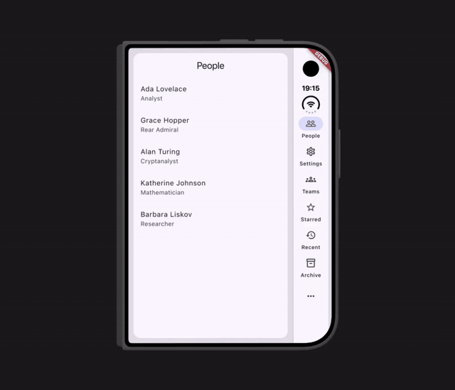

# adaptive_nav

A Navigator 2.0 router that renders **one** navigation state two ways — a stack
on a phone, master-detail panes on a tablet or desktop — and keeps screen state
across the switch.

Rotate the device, drag the window edge, unfold a foldable: the layout changes,
the screens do not. Scroll offsets, half-typed text fields, controllers and
animations all survive, because nothing is remounted — the branch `Navigator`s
move between the layouts under stable `GlobalKey`s.

The package is generic over your route type `R` and knows nothing about your
screens. You supply the branches, the `R ↔ URL` codec and the guards.

> **Status.** The package runs in production in the author's own apps, so it
> is under active development. Until 1.0 a minor version may break the API;
> every such change is listed under `### Breaking` in the
> [CHANGELOG](CHANGELOG.md).

> **Ready for iPhone Duo.** The rail moves into the system's own column,
> under the camera and the clock, and follows it as the phone folds and turns;
> the inner display gets two panes, with a rail in landscape and a bottom bar
> in portrait, and half open they meet on the hinge. The screens keep their
> state through every fold. Nothing to configure, and one line with
> [adaptive_nav_ios](https://pub.dev/packages/adaptive_nav_ios) for Split View
> and the hinge — see [iPhone Duo](#iphone-duo).



**[Try it in the browser](https://nightdevcraft.github.io/adaptive_nav/)**: the
example app in a desktop window you can resize, on a phone and a tablet you can
rotate, and on iPhone Duo and Galaxy Z Fold8 you can fold.

## Install

```yaml
dependencies:
  adaptive_nav: ^0.15.0
```

## Quick start

Define a route type and a codec, describe your branches, and hand an
`AdaptiveNav` to `MaterialApp.router`. The route type needs value equality
(`==` and `hashCode`): `NavEntry` equality and the URL parser compare routes
with it.

```dart
import 'package:adaptive_nav/adaptive_nav.dart';
import 'package:flutter/material.dart';

@immutable
sealed class AppRoute {
  const AppRoute();
}

class PeopleList extends AppRoute {
  const PeopleList();

  @override
  bool operator ==(Object other) => other is PeopleList;

  @override
  int get hashCode => (PeopleList).hashCode;
}

class PersonDetail extends AppRoute {
  const PersonDetail(this.id);

  final int id;

  @override
  bool operator ==(Object other) => other is PersonDetail && other.id == id;

  @override
  int get hashCode => Object.hash(PersonDetail, id);
}

class SettingsRoute extends AppRoute {
  const SettingsRoute();

  @override
  bool operator ==(Object other) => other is SettingsRoute;

  @override
  int get hashCode => (SettingsRoute).hashCode;
}

class AppCodec extends RouteCodec<AppRoute> {
  const AppCodec();

  @override
  Uri encode(AppRoute route) => switch (route) {
    PeopleList() => Uri.parse('/people'),
    PersonDetail(:final int id) => Uri.parse('/people/$id'),
    SettingsRoute() => Uri.parse('/settings'),
  };

  @override
  AppRoute decode(Uri uri) {
    final List<String> seg = uri.pathSegments;
    if (seg.isNotEmpty && seg.first == 'settings') {
      return const SettingsRoute();
    }
    final int? id = seg.length >= 2 ? int.tryParse(seg[1]) : null;
    return id != null ? PersonDetail(id) : const PeopleList();
  }

  // Which tab a route belongs to.
  @override
  int branchOf(AppRoute route) => switch (route) {
    PeopleList() || PersonDetail() => 0,
    SettingsRoute() => 1,
  };
}

// Your screens, one per route.
Widget buildPage(AppRoute route) => switch (route) {
  PeopleList() => const Text('People'),
  PersonDetail(:final int id) => Text('Person $id'),
  SettingsRoute() => const Text('Settings'),
};

final shellConfig = AdaptiveShellConfig<AppRoute>(
  branches: <BranchConfig<AppRoute>>[
    BranchConfig<AppRoute>(
      id: 'people',
      icon: Icons.people_outline,
      label: 'People',
      // Present: this branch splits into master + detail when there is room.
      masterDetail: const MasterDetailConfig(paneRatio: 0.36),
      pageBuilder: buildPage,
    ),
    BranchConfig<AppRoute>(
      id: 'settings',
      icon: Icons.settings_outlined,
      label: 'Settings',
      pageBuilder: buildPage, // no masterDetail: a plain tab
    ),
  ],
);

// The starting state: one stack per branch, each holding its root.
final initialState = NavState<AppRoute>(
  activeBranch: 0,
  branches: <BranchStack<AppRoute>>[
    BranchStack<AppRoute>(<NavEntry<AppRoute>>[
      NavEntry<AppRoute>(
        route: const PeopleList(),
        transition: AppTransition.platform,
      ),
    ]),
    BranchStack<AppRoute>(<NavEntry<AppRoute>>[
      NavEntry<AppRoute>(
        route: const SettingsRoute(),
        transition: AppTransition.platform,
      ),
    ]),
  ],
);

class App extends StatefulWidget {
  const App({super.key});

  @override
  State<App> createState() => _AppState();
}

class _AppState extends State<App> {
  final AdaptiveNav<AppRoute> nav = AdaptiveNav<AppRoute>(
    shellConfig: shellConfig,
    initialState: initialState,
    codec: const AppCodec(), // optional: URLs and deep links
  );

  @override
  void dispose() {
    nav.dispose();
    super.dispose();
  }

  @override
  Widget build(BuildContext context) => MaterialApp.router(routerConfig: nav);
}

void main() => runApp(const App());
```

`AdaptiveNav` is a `RouterConfig`: the delegate, the URL parser and provider
and the back button dispatcher, plus the navigation API. It creates and
disposes all of them itself. `AdaptiveRouterDelegate` and
`AdaptiveRouteInformationParser` are still public for an app that wires the
`Router` by hand.

A complete, runnable app is in [`example/`](example).

## The layouts

Chrome and pane count are decided **separately**, so they combine rather than
step through fixed states:

| Window width | Chrome | Panes |
| --- | --- | --- |
| `< 600` (compact) | `NavigationBar` | master in the body, detail as an overlay **over the bar** |
| `≥ 600`, `MasterDetailConfig.fits` is false | `NavigationRail` | one pane — the detail covers the master **and the rail** |
| `≥ 600`, `MasterDetailConfig.fits` is true | `NavigationRail` | two panes — master \| detail |

The width is measured without the side insets. With the defaults — a rail of
80 plus its 1-point divider, minimums of 320 and 360, no pane margins, gap or
side insets — `fits` turns true from 761 across.

A bar with two panes above it is the fourth combination, and it exists for one
device: iPhone Duo's inner display in portrait is 669 points across and Apple
asks for horizontal bars there. See [iPhone Duo](#iphone-duo).

Where the chrome goes is `AdaptiveShellConfig.chromeLayout`, which returns a
`ChromePlacement` — `bottom`, `left` or `right` — from the window, its padding
and the `SystemGeometry` a platform package reported, if any.
The pane count is decided by `MasterDetailConfig.fits` — whether the master and
the detail both fit at their minimum widths, with the decoration's margins, the
gap and any safe-area inset the panes only bleed under already subtracted. A
wide window with a narrow content area therefore stays single-pane, which is
the right answer.

Below 600 across (`kCompactWidthBreakpoint`, without the side insets) a branch
is always one pane, whatever the minimums. Otherwise a narrowing window would
drop to one pane beside the rail and jump back to two as soon as the bar
replaced it and gave its width back.

`PaneMetrics` is that arithmetic, exported so an app that decides "is this the
wide layout" for itself arrives at the same number:

```dart
final Size window = MediaQuery.sizeOf(context);
final EdgeInsets padding = MediaQuery.paddingOf(context);
final double panes = PaneMetrics.paneAreaWidth(
  window: window.width,
  padding: padding,
  placement: shellConfig.chromeLayout(
    window,
    padding,
    SystemGeometryScope.maybeOf(context),
  ),
  railWidth: shellConfig.railWidth,
  panes: shellConfig.panes,
  rail: shellConfig.rail,
);
```

While the detail is empty, `collapseWhenDetailEmpty` (default `true`) collapses
the split and gives the master the full width — no placeholder column next to an
empty pane. Set it to `false` and the empty detail shows
`BranchConfig.detailPlaceholder` instead. Either way both of the branch's
navigators stay mounted, so no state is lost when the split appears or goes.

### A detail and the chrome

Where the detail opens over a single pane — a phone, or a rail beside one
pane — `AdaptiveShellConfig.detailChrome` decides what happens to the bar or
the rail:

- `DetailChrome.covered` (the default, every platform): the detail takes the
  whole window, the chrome included, and the chrome comes back with the
  detail's own transition. That is Material's detail screen: full screen,
  over the navigation, and back is how you leave it. On iPhone Duo's outer
  display the column is the system's, not the chrome: only the rail's
  destinations go. The status area, the column's background and the
  detail's toolbar stay, the toolbar now with all of the column to itself,
  and the detail stands beside the column, where the pane was, with the
  padding the pane had — none on the column's side. With the column at the
  leading edge, iOS's swipe back starts at the window's edge, in the column,
  as it does at the detail's own; a tap on the column's buttons stays a tap.
- `DetailChrome.kept` (iOS and macOS): the bar or the rail stays in view and
  in use, as UIKit keeps a tab bar beside a pushed screen that does not set
  `hidesBottomBarWhenPushed`. Over a bottom bar the detail ends at the bar's
  top edge; a tab tapped from the detail switches branches as anywhere else,
  and the detail is still there when you come back. On iPhone Duo the column
  reads status bar, Back, actions, tab bar — the order Apple's Human
  Interface Guidelines give a vertical bar.

On iPhone Duo with the column at the leading edge, the swipe back starts in
the column for whatever single pane stands beside it and can go back: a
covering detail, a kept one, a screen over either, a screen pushed in a plain
tab. The swipe starts anywhere from the window's edge to the pane's, the
rail's divider included. At a tab's root there is nothing to go back to and
the column is only buttons. Taps on the tabs, More and the toolbar stay taps; a finger becomes
a swipe only once it moves sideways past the slop. With two panes nothing
changes.

`kept` is honoured only where `Theme.of(context).platform` is iOS or macOS and
is ignored elsewhere, without an assertion, so one config serves every
platform. A tab bar left beside a detail is an iOS pattern, not a Material one;
and the theme rather than the host decides, so an app that overrides the
platform behaves as that device.

Two panes are not affected: the detail has a pane of its own beside the master
and the chrome stays either way.

## The API

Navigation is imperative and lives on `AdaptiveNav` (and on the delegate it
forwards to):

```dart
nav.push(route, transition: ..., onExit: ...); // returns a result future
nav.pop();
nav.popWithResult(value);
nav.replace(route);
nav.resetTo(route);        // branch becomes [route]
nav.resetDetailTo(route);  // branch becomes [root, route]
nav.popToRoot();
nav.goBranch(index, resetToRoot: false);
nav.reevaluate();          // re-run the redirect hook
nav.state;                 // the current NavState
```

To react to every change, listen to `nav.routerDelegate`.

### Holding it in a provider

`AdaptiveNav` is not a `Listenable`, so a dependency container that rejects
change notifiers — `riverpod_lint`'s `unsupported_provider_value`, for one —
takes it as is. Nothing else needs a provider of its own: app state that drives
the router stays an ordinary notifier and is pushed in.

```dart
@Riverpod(keepAlive: true)
AdaptiveNav<AppRoute> nav(Ref ref) {
  final nav = AdaptiveNav<AppRoute>(
    shellConfig: shellConfig,
    initialState: initialState,
    codec: const AppCodec(),
    immersive: ref.read(fullscreenProvider),
    resizablePanes: true,
    onPaneCommit: (branchId, fraction) => saveFraction(branchId, fraction),
  );
  ref.listen(fullscreenProvider, (_, bool on) => nav.immersive = on);
  ref.listen(sessionProvider, (_, _) => nav.reevaluate());
  ref.onDispose(nav.dispose);
  return nav;
}
```

`transition` takes an `AppTransition`: `platform`, `fade`, `modal`, `none`, or
`adaptive` (see below). Left out, it falls back to `BranchConfig.transition`.

`resetDetailTo` is the lateral move of a master-detail list: picking another
item replaces a detail of any depth — a card with an editor on top of it — in a
**single** state mutation, so the pane never flickers through an empty frame.

## Exit guards

An entry can carry an `onExit` guard, and **every** way out goes through it:
back, gesture, app bar, `replace`, `resetTo`, `popToRoot`, `resetDetailTo`, and
switching tabs.

```dart
nav.push(
  PersonEdit(id),
  onExit: () => confirmDiscard(context), // Future<bool>
);
```

A tab switch is gated too. The screen is only parked, not destroyed, but the
user is asked about unsaved work all the same — and a refusal leaves the tab
where it was. Screens without a guard never prompt, and such a switch stays
synchronous, completing in the same frame.

## System back

The shell tells Android in one answer whether back belongs to the app, so
predictive back reaches the app whenever there is something to go back from:
a dialog, the shell drawer, a pushed screen, a detail pane, a `PopScope` that
blocks pop.

For predictive back on Android, set `android:enableOnBackInvokedCallback="true"` on `<application>` in `AndroidManifest.xml`.

Back — the button, the predictive back gesture, the iOS edge swipe — acts on
the active tab only. The other tabs keep their screens mounted, and those
screens decline back while their tab is out of view, as a `PopScope` with
`canPop: false` would: a detail left open in another tab is there when you
return to it.

A drawer or a `Scaffold.showBottomSheet` **inside a screen** is not reported —
the same as in a plain `MaterialApp` — so at a branch root back closes the app
instead. Block pop while the drawer is open and close it yourself:

```dart
class _InboxState extends State<Inbox> {
  final GlobalKey<ScaffoldState> _scaffold = GlobalKey<ScaffoldState>();
  bool _drawerOpen = false;

  @override
  Widget build(BuildContext context) {
    return PopScope(
      canPop: !_drawerOpen,
      onPopInvokedWithResult: (bool didPop, Object? _) {
        if (!didPop) _scaffold.currentState?.closeDrawer();
      },
      child: Scaffold(
        key: _scaffold,
        drawer: const Drawer(child: Filters()),
        onDrawerChanged: (bool open) => setState(() => _drawerOpen = open),
        body: const InboxList(),
      ),
    );
  }
}
```

At a branch root back goes to the system. With
`AdaptiveShellConfig.backToBranch: 0` back at the root of any other branch
switches to the start tab instead. The root's `onExit` is asked as on a tab
tap. The switch has no predictive back preview.

## Deep links

`AdaptiveRouteInformationParser` turns an incoming URL into a `NavState` with
your `RouteCodec`, and reports the current location back for the address bar.
The round trip is defined on the visible location — the top of the active
branch. Like `go_router`, a deep link opens the target screen rather than
synthesising a multi-level back stack for it.

A link changes only its own branch and keeps what it can there: the branch's
current root stays, and a screen already open in the stack is reused, with the
stack cut back to it. Screens cut off this way are **not** asked through their
`onExit`; their `push` futures complete with `null`.

`AdaptiveShellConfig.redirect` is the auth guard: it can substitute the state
before it is applied. It runs once at start (on the first location with a
codec, on the first frame without one), on incoming URLs and on
`AdaptiveNav.reevaluate()`, which is the equivalent of
`refreshListenable` — call it when the session changes.

## Chrome

- `barBuilder` / `railBuilder` replace the Material default completely — your
  own pill, your own icons, your own destinations. They receive **branch**
  indices, so nothing is mapped twice, and may return `null` to hide the chrome
  for a frame. A custom rail has to be exactly `AdaptiveShellConfig.railWidth`
  wide: the layout is computed from that number, and a rail that disagrees with
  it throws the detail pane width off by the difference.
- `drawerBuilder` adds a `Scaffold.drawer`, with `scaffoldKey` to open it from
  anywhere. It receives whether the layout currently uses the rail.
- `showsChrome` hides the bar and rail for a given state — an auth area with no
  tabs. Only the chrome widget goes; the branch navigators stay mounted.
- `BranchConfig.showsInChrome: false` keeps a branch navigable but gives it no
  destination (a profile or auth branch, entered programmatically).
- `extendBodyBehindBar` extends the body under a floating bar. It is off by
  default, because under the opaque default `NavigationBar` the content would
  simply disappear.
- `branchFadeDuration` turns tab switches into a Material "fade through"
  instead of an instant swap.

### Tapping the active tab again

A tap on the destination already selected goes back to the branch root, as
`UITabBarController` does on iOS and as Material advises — from the bar, the
rail, the tabs in iPhone Duo's column, More's ticked item, and from a
`barBuilder` or `railBuilder` that calls `onSelectBranch` with the active
branch. It is `popToRoot`: every `onExit` above the root is asked, and a
refusal keeps the stack. In a master-detail branch the root is the master,
so the detail goes too.

`onReselect` hears every such tap, with whether anything was popped. At the
root it is `false`, which is where iOS scrolls the list to the top:

```dart
AdaptiveShellConfig<AppRoute>(
  branches: branches,
  onReselect: (int branch, bool popped) {
    if (!popped) scrollControllers[branch].animateTo(0, ...);
  },
)
```

`reselect: BranchReselect.none` turns the pop off and keeps `onReselect`.

## Snack bars

Each pane has its own `ScaffoldMessenger`, so a message raised from a screen
appears once, in the pane the action came from, rather than twice on a phone or
stretched under both panes on a tablet. Calling
`ScaffoldMessenger.of(context)` from any screen inside a pane already lands on
the right one.

For something that belongs to no pane in particular, `AdaptiveNav` exposes both:

```dart
nav.masterMessenger?.showSnackBar(const SnackBar(content: Text('Synced')));
nav.detailMessenger?.showSnackBar(...);
```

## Panes

`PaneDecoration` makes the panes floating rounded cards on a canvas, and
`RailDecoration` does the same for the rail:

```dart
panes: PaneDecoration(
  margin: const EdgeInsets.all(12),
  gap: 8,
  radius: BorderRadius.circular(16),
  canvasColor: (context) => Theme.of(context).colorScheme.surfaceContainerHighest,
  splitHandleColor: (context) => Theme.of(context).colorScheme.outlineVariant,
),
```

The margins and the gap are **data**, not decoration painted on top: they reduce
the width left to the panes and therefore move the "one pane or two" threshold.
If your screens compute the layout with a formula of their own, they have to
subtract the same values.

The boundary sits at `MasterDetailConfig.paneRatio` of the pane area.
`alignToWindowCenter: true` puts it on the window's horizontal centre instead,
so a rail on the left comes out of the master's half. `portraitPaneRatio`
replaces both in a portrait window — a narrow list there, the centre in
landscape. The user's drag and an active fold ([Half open](#half-open)) still
win, and so do the pane minimums.

`resizablePanes: true` makes the boundary draggable, per branch, clamped by
both panes' minimum widths. The chosen width goes out on release, so it can be
persisted:

```dart
final nav = AdaptiveNav<AppRoute>(
  // ...
  resizablePanes: true,
  paneFractions: loadedFractions, // if you already have them
  onPaneCommit: (branchId, fraction) => save(branchId, fraction),
);

// Or seed it later, once an async read comes back. Branches the user has
// already dragged in this session are left alone.
nav.paneSplit!.restore(await loadFractions());
```

`nav.immersive = true` slides the rail out of the wide layout and hands the
strip to the panes; pass `immersive: false` to the constructor to enable the
mode. It changes geometry only: the layout class stays frozen, so a branch
never crosses the two-pane threshold mid-animation.

With a hand-built `Router`, the same two live in the config as
`AdaptiveShellConfig.paneSplit` (a `PaneSplitController` the app owns) and
`AdaptiveShellConfig.immersive` (a `ValueListenable<bool>`).

## What screens can read

Inherited scopes let your screens adapt without recomputing the layout:

- `DetailEntryScope.isDetailRoot(context)` — this screen is the branch's first
  detail. In the wide layout it fills the pane, so its app bar should offer a
  close button (clearing the selection) rather than a back arrow.
  `Navigator.canPop()` cannot answer that: a transparent base page always sits
  underneath.
- `DetailPaneScope.of(context)` — the detail is in its own pane;
  `DetailPaneScope.isFullScreen(context)` — it is a detail shown across the
  whole area. Covering the navigation bar (`DetailChrome.covered`), its bottom
  edge becomes its own responsibility.
- `PaneBarScope.of(context).verticalEdge` — the pane's toolbar stands in the
  system's column on iPhone Duo; `PaneToolbar` reads it for you, see
  [The toolbar beside the system's bar](#the-toolbar-beside-the-systems-bar).
- `StatusRowScope.trailingReserveOf(context)` — for the experimental headers in
  the status row, see [Inner display](#inner-display).

`AppTransition.adaptive` uses the same signal: a detail fades when it swaps the
contents of a pane and gets the platform slide when it takes the whole screen —
and it decides that while the animation runs, so the dismissal matches the
layout the user is actually looking at.

## Notes

**The keyboard is the focused pane's business.** Both shell `Scaffold`s run
with `resizeToAvoidBottomInset: false`, so a screen inside a pane needs its own
`Scaffold` or its own handling of `viewInsets.bottom`.

**The layout is decided at build time**, from `MediaQuery`, never inside a
`LayoutBuilder`.

**Branches are mounted lazily**, on first entry, and live from then on.

The reasoning behind these, and behind most of the design, is in
[`doc/design.md`](doc/design.md).

## iPhone Duo

A fold is a window resize, so folding and unfolding cost nothing here: the
screens survive it the same way they survive a rotation. What makes iPhone Duo
different is where the system puts its own bars. The status bar is a vertical
strip 84 points wide along one edge, which edge it is changes as the device is
folded and turned, and Apple asks that an app's bars follow it —
[Designing for iPhone Duo](https://developer.apple.com/design/human-interface-guidelines/designing-for-iphone-duo).
The one exception is the inner display in portrait, which has the vertical room
for ordinary horizontal bars.

The package does that out of the box, from one of two sources:

- **[adaptive_nav_ios](https://pub.dev/packages/adaptive_nav_ios)**, one line
  around the app. It reads UIKit — `UITraitCollection.verticalBarEdge` for the
  side of the bar, `UIView.reservedRegions` for the status area and the fold —
  and hands the shell a `SystemGeometry` through a `SystemGeometryScope`:

  ```dart
  void main() => runApp(const DuoGeometryProvider(child: MyApp()));
  ```

- **`MediaQuery.padding`**, without it. A substantial inset on exactly **one**
  side is the system's bar, and `SystemBarMetrics` supplies the sizes UIKit
  would have reported. No platform channel, nothing to configure.

Both give the same layout in every posture but one, below. The sizes were
measured on the iPhone Duo simulator under Xcode 27.1 (iOS 27.1); the status
area is the active occlusion `reservedRegions` reports against the window's
edge, and the reserve is how far along the rail's column it reaches.

| # | Posture | Window | Safe area | Status area | Chrome | Reserve | Pane area |
| --- | --- | --- | --- | --- | --- | --- | --- |
| 1 | outer, portrait | 466 × 678 | right 84 | 382…466 × 0…170 | rail, right | 170, top | 377 |
| 2 | outer, landscape | 678 × 466 | left 84 | 0…84 × 0…82 | rail, left | 82, top | 589 |
| 3 | outer, landscape, turned the other way | 678 × 466 | right 84 | 594…678 × 384…466 | rail, right | 82, bottom | 589 |
| 4 | inner, portrait | 669 × 951 | top 82 | 535…669 × 0…82 | bar, bottom | — | 669 |
| 5 | inner, landscape | 951 × 669 | right 84 | 867…951 × 0…120 | rail, right | 120, top | 862 |
| 6 | inner, landscape, half open | 951 × 669 | right 84 | 867…951 × 0…120 | rail, right; panes meet on the fold at 475.5, 20 inset each side | 120, top | 862 |
| 7 | inner, portrait, half open | 669 × 951 | top 82 | 535…669 × 0…82 | bar, bottom; the fold is horizontal and ignored | — | 669 |
| 8 | Split View, left half | 469 × 669 | none at the sides | none | rail, left (with adaptive_nav_ios); bar, bottom (without) | 16 | 388 / 469 |
| 9 | Split View, right half | 469 × 669 | right 84 | 385…469 × 0…120 | rail, right | 120, top | 380 |

The half-open postures need adaptive_nav_ios to be seen at all: the framework
leaves `MediaQuery.displayFeatures` empty on iOS, half open included.

**The one posture the fallback gets wrong is 8.** The left-hand window of Split
View has no inset on either side — the status bar is in the other window — yet
the system wants this window's bar on its left edge, the outer edge of the
display: `verticalBarEdge` names the edge the window's own bar belongs on, not
the side the status bar is on. Without adaptive_nav_ios the shell sees a narrow
window and puts a bottom bar there. `chrome_layout_test.dart` pins that, so the
day it changes is a decision rather than an accident.

### The rail in the system's column

The rail joins the system's column rather than taking one of its own — on the
outer display the camera is at one end of it and the controls are meant to line
up with it, and on the inner one the glyphs are. To sit *with* them the rail
needs to know how far along the column the system's own elements reach, and
which vertical line they are centred on.

How far is the status area: with adaptive_nav_ios the reserve is the reported
area itself, down to its bottom edge or, with the area at the bottom of the
column, up to its top edge. Without it `SystemBarMetrics.measured` holds the
same areas: 170 points on the outer display upright, 82 in landscape, where the
system hides the clock, and 120 on the inner display, landscape and Split View
alike. The outer and inner displays are told apart by the size of the
**display**, not the window — a Split View window is 469 across, narrower than
the outer display — through `View.display`. The line is 48 points in from the
window edge, where the camera is centred, rather than the middle of the
84-point column. All of it is `AdaptiveShellConfig.systemBar`;
`SystemBarMetrics.none` ignores the bar, and the status area, entirely.

On the outer display the camera is in a corner of the glass, so turning the
phone moves the status area along the column: at the top upright and with the
column on the left, at the bottom with the column on the right. The inner
display keeps it at the top in either landscape orientation. Without a status
area to say which end, `SystemBarMetrics.end` decides from the window, the
column's side and the display.

In that column the shell draws neither Material's rail nor a single stack of
controls, but **two zones**, as Apple does: the screen's toolbar at the top,
below the status area, and the tabs at the bottom, within reach of the thumb
of the hand holding the phone ("Vertical controls", Tech Talk 111462). Every
button is a circle of 48 points, `kPaneToolbarItemExtent`, centred on the
column's axis. The tabs are one group, as Apple draws the tab bar in one
capsule, 6 apart (`kPaneToolbarItemGap`): four of them are 48 × 210. Two
separate buttons of the toolbar are 12 apart, `kPaneToolbarGroupGap`, and so
are the two zones. The
column keeps `SystemBarMetrics.columnInset` (24) at both ends: the first
button starts 24 below the status area — or below the window's edge where the
status area is at the column's bottom end — and the last tab ends 24 above the
window's edge, inside the home indicator's inset, or 24 above the status area
at the bottom. All of these are Safari's and Settings' buttons measured on the
simulator.

**The tabs' places come from the column alone.** How many there are depends
on the column's height and `AdaptiveShellConfig.railLabelsInColumn`, never on
the selected tab or the screen's toolbar, so switching tabs or screens moves no
tab; only a new window size — turning the phone, folding it, Split View —
changes them, and then they grow or shrink about the bottom edge. No room is
kept for a toolbar: as with Apple's tab bar (`prefersTabBar`, the default), a
screen without buttons leaves the whole column to the tabs.

How many tabs have a place, with labels of one line; one more than that, and
the last place is More. The last column is the number of tabs from which a
root with one button, Starred's Filters, folds them (see below; — is never),
and what the toolbar has beside the two places the folded tabs keep:

| Posture | `none` / `all` / `selected` | More from | One button folds from | Folded, the toolbar has |
|---|---|---|---|---|
| 1. Outer display, upright | 8 / 6 / 6 | 9 / 7 / 7 | 8 / 6 / 6 | 346 / 310 / 310 |
| 2, 3. Outer display, turned | 6 / 4 / 4 | 7 / 5 / 5 | 6 / 4 / 4 | 222 / 186 / 186 |
| 5, 6. Inner display, landscape | 9 / 6 / 6 | 10 / 7 / 7 | 9 / — / — | 387 / 351 / 351 |
| 9. Split View, right half | 9 / 6 / 6 | 10 / 7 / 7 | 9 / — / — | 387 / 351 / 351 |

`test/column_capacity_test.dart` works the table out with the shell's own
arithmetic. The short column of the outer display turned — 336 points between
its ends — keeps the tabs only for an app with a few sections and no labels:
with five or more, any screen with a button folds them; with labels, four.

When there are more tabs than places, the last place is **More**, as on an
iPhone's tab bar (`UITabBarController`; Apple does not describe the case for a
vertical tab bar). Its icon is a grid, not an ellipsis — that is the toolbar's
menu — and it opens a menu of the tabs without a place. Which ones those are
is `BranchConfig.visibilityPriority`'s: the lowest, and among equals the last;
with none set, the ones at the end. The order never changes, and a selected
tab never leaves its place or pushes another out of one: a hidden tab
selected lights More up, ticked in its menu, and the places stay as they are.
`AdaptiveShellConfig.railOverflowBuilder` draws More instead of the package.

**The labels are the app's call** (`railLabelsInColumn`):

- `NavigationRailLabelType.none`, the default: icons, as Apple draws a
  vertical tab bar; the label is the tooltip and the semantic label.
- `NavigationRailLabelType.all`: a label under every icon.
- `NavigationRailLabelType.selected`: a label under the current tab only, but
  the room for one is kept under every tab. A label that came and went with
  the selection would shift every tab below it on each switch, and change how
  many fit.

Elsewhere — a desktop window, a tablet, Android — the rail is Material's
`NavigationRail`, at the top of a column of its own (`railAlignment` can move
it), and its destinations are counted the same arithmetic way: Material's rail
neither scrolls nor wraps and past its height simply overflows, so the shell
puts the rest behind a menu button (`AdaptiveShellConfig.railOverflow`, on by
default). The count lays the labels out with a `TextPainter` — a
`LayoutBuilder` around the rail is the one thing `doc/design.md` warns against
— and a label too wide for the rail takes a second line, that destination
growing alone: "Home" is 64 points beside "People"'s 80. The button is
`railOverflowBuilder`'s to draw, in a slot of 56 points that stays with the
shell, and `railDestinationExtent` declares one height for every destination.

### The toolbar beside the system's bar

Apple lays the column out top to bottom as the status area, the navigation
button (Back or Close), the prominent action (Done), the other groups of
actions after a gap, and the tab bar at the bottom ("Vertical controls", Tech
Talk 111462). Only the pane against the system's bar gets a vertical toolbar:
the single pane on the outer display and in either Split View window, and the
detail of a master-detail pair on the inner display in landscape. A master
keeps its header, and so does everything on the inner display in portrait.

`PaneToolbar` describes a screen's toolbar once, and the shell decides where it
goes. Its builder gets a ready `leading` and `actions` for the `AppBar` where
the toolbar is a header, and nothing where it is vertical — the shell draws the
items itself, in the column, which on the outer display is not part of the pane
at all:

```dart
PaneToolbar(
  // navigation: null decides — Close on the first screen of a detail, Back
  // where there is something to go back to.
  pinned: <PaneToolbarItem>[
    PaneToolbarItem(icon: Icons.edit_outlined, label: 'Edit', onPressed: edit),
  ],
  groups: <List<PaneToolbarItem>>[
    <PaneToolbarItem>[
      PaneToolbarItem(icon: Icons.share, label: 'Share', onPressed: share),
    ],
  ],
  builder: (BuildContext context, PaneToolbarLayout toolbar) => Scaffold(
    appBar: AppBar(
      leading: toolbar.leading,
      automaticallyImplyLeading: toolbar.automaticallyImplyLeading,
      title: const Text('Ada Lovelace'),
      actions: toolbar.actions,
    ),
    body: body,
  ),
)
```

**Screens without one get Back automatically**, as `UINavigationController`
puts Back in the vertical bar whatever a screen's own bar holds. Where the
pane's toolbar is vertical, the shell stands the navigation button a
`PaneToolbar` would pick — Close on the first screen of a detail or a
full-screen dialog, Back where there is something to go back to, nothing on a
root — in the column for the screen on top, and that screen's `AppBar` draws
no arrow meanwhile; it pops through the same exit guards, changes with the
route's transition and follows a swipe back. Where the toolbar is a header the
`AppBar` has its arrow as usual, and a change of pose moves it there and back.
A screen that has decided for itself is left alone: an `AppBar` with a
`leading` of its own, or with `automaticallyImplyLeading: false`, keeps its
header, and the column gets nothing, so there are never two.
`AdaptiveShellConfig.automaticBackInColumn: false` turns it off. A screen with
actions still wants a `PaneToolbar`: its `AppBar.actions` stay in the header.

- **The label is not optional.** It is the tooltip and the item's text in a
  menu. An item without an icon is a text button and stays in the header, as
  does one marked `horizontalOnly`: a word does not fit an 80-point column.
- **Only the screen on top of its pane's navigator** is drawn in the column.
  From one screen to the next, the toolbar's zone changes with the screen's
  route transition, as `UINavigationBar` does: the old buttons are gone by
  its middle and the new ones come in after it, and a swipe back or
  predictive back leads them by the finger. A tab switch cross-fades over
  `PaneToolbar.duration`; a transition without animation changes them at
  once. The tabs do not move, and the screens are not built again for it.
- **The sizes:** circles of 48 points, Close or Back in one of its own, 6
  apart within a group (`kPaneToolbarItemGap`, Safari's capsule) and 12
  between groups, starting 24 below the status area.
- **The pinned items are tinted, not filled** — the icon in the scheme's
  primary colour, in the column and in the header alike. A filled circle is
  what marks the selected tab further down.
- **In the header** it shows up to `maxHeaderActions` (3) and puts the rest
  behind a `more_horiz` menu, the least important first.

The toolbar gets the column less the tabs' zone and 12 between the two. What
does not fit it, one of the two gives way — `BranchConfig.verticalCompression`,
which a screen's `PaneToolbar.compression` overrides:

- `VerticalBarCompression.toolbarFirst` (the default; Apple's
  `prefersTabBar`): the tabs keep their places, and toolbar items go behind
  the toolbar's own "•••" menu, the last button of its zone — the lowest
  `visibilityPriority` first and among equals the lowest in the column. The
  navigation button never goes. When the tabs leave too little even for the
  navigation button and the menu — or for the menu alone, with no navigation
  button — they fold, as below, and unfold when a screen
  that fits comes back. The folded tab bar is Apple's `prefersToolbarItems`
  (Tech Talk 111462), taken here only where nothing less fits. A third-party
  measurement on the iOS 27.1 simulator reports the system's tab bar folding
  on its own in the short column of the outer display turned
  ([liquid_glass_widgets#348](https://github.com/sdegenaar/liquid_glass_widgets/issues/348));
  Apple does not describe it.
- `VerticalBarCompression.tabsFirst` (`prefersToolbarItems`): when the
  toolbar does not fit beside the tabs whole, the tabs fold.

Folded, the tabs are two buttons at the bottom of the column: More, with its
icon and in its place, now with a menu of every tab, the current one ticked;
and above it the selected tab, filled, which does on a tap what it does
unfolded. The toolbar gets the rest. Where even two places leave too little
for the navigation button and "•••" — or "•••" alone — More stays alone,
filled. Folding and unfolding as screens change go with the screen's
transition: the other tabs are gone by its middle, where they stand, the
selected one moves down to its place above More over all of it, More does
not move, and no screen is built again for it; unfolding is the same
backwards. It is the one time the tabs change as you move between
screens; between screens that fit, they do not move at all.

The two menus never mix: "•••" is the toolbar's, More is the tabs'. All of
this is the column beside a pane whose tabs stay: a master, a tab without a
detail, the detail of two panes on the inner display, or any detail with
`DetailChrome.kept`. A detail that covers the tabs (the default) has the
column to itself, Close and Edit at its top; the tabs go out under it with
its transition, by its middle, and come back with it after the middle of its
way out.

With a `chromeLayout` that keeps the rail away from the system's column, the
toolbar has the column to itself, with the same ends, and
`SystemBarMetrics.statusColumnWidth` (72) across.

### What it means for an app

- **Nothing changes on any other device.** All of the above applies only where
  one side of the window has a vertical bar of 60 points or more and the other
  does not, or where a `SystemGeometry` names a side — which only
  adaptive_nav_ios does, and only on iPhone Duo. A notched iPhone in landscape
  has large horizontal insets, but symmetric ones; a display cutout or
  Android's navigation buttons are one-sided but far narrower; the rail moves
  its destinations past them. `chrome_layout_test.dart` and
  `duo_poses_test.dart` pin every phone, tablet and desktop case to the layout
  the package always gave it.
- **Add adaptive_nav_ios for Split View and the fold.** Without it the left
  half of Split View gets a bottom bar and the panes ignore a half-open hinge;
  everything else is the same.
- **The inner display in portrait needs smaller minimums.** It is the roomiest
  posture — no rail takes a share, so all 669 points go to the panes — but the
  defaults ask for 680. Pick `masterMinWidth` and `detailMinWidth` that fit,
  the way [`example/`](example) does with 270 and 270, or accept a single stack
  there. The outer display is under 600 across, so it stays a stack whatever
  the minimums, as Apple asks.
- **Build against the iOS 27.1 SDK.** Older SDKs put the app in a compatibility
  box (375 × 667) on both displays, so none of the above applies and nothing
  can be tested.

What the package does **not** do is place your screens' own toolbar items. The
guidance there — Back and Close at the top of the vertical axis, prominent
actions next, the rest in their original groups — is for the `AppBar` inside
each pane, which is yours.

### Half open

While the device is half open the inner display is two planes at an angle, and
a pane straddling the crease is bent across both. `MasterDetailConfig.alignToFold`
(default `true`) puts the boundary on the fold instead of where `paneRatio` or a
drag would have it. The panes meet on the line of the hinge — the middle of the
crease — and the crease is an inset, not a gap: each pane's background reaches
the hinge, and its screens get half the crease (20 points on iPhone Duo) as
`MediaQuery.padding` on that side, the way a pane reaches under the system's
insets, so content written against the safe area stays off the bend without
knowing about it. With `PaneDecoration` cards the gap is split evenly around
the hinge and counts towards the inset; it does not move the boundary. The
pane minimums are checked against the width less the inset, what the user
sees. The divider stops being draggable while it holds — the hinge decided —
and the app's own width comes back the moment the device is flat again, so the
boundary moves once and once back.

Only a fold that is vertical, active and inside the pane area counts, and it is
looked for in three places, in order:

1. `MediaQuery.displayFeatures`, which the framework fills on Android — a
   book-style Android foldable gets this today — and not yet on iOS.
2. `SystemGeometry.folds`, which adaptive_nav_ios fills on iPhone Duo with the
   active divisions from `reservedRegions`. The fold is reported 40 points
   across, a line with 20 of margin either side, and only while half open:
   flat, it is there but inactive and the width decides.
3. `AdaptiveShellConfig.foldLocator`, the app's own answer, for a device
   nothing reports.

Device Hub in Xcode 27.1 has a half-open posture (at a fixed angle, about 128°),
so this can be tried on the simulator; `fold_split_test.dart` and
`duo_poses_test.dart` inject the fold directly.

## Tests

The package ships with a widget-test suite covering the invariants above:
rotation and resize preservation, the three layouts, the master-detail split and
its collapse, back handling and guards on every exit path, URL round trips, tab
state, lazy branches, pane decoration geometry, divider dragging, immersive
mode, keyboard insets and snack-bar scoping.

```sh
flutter test
```
